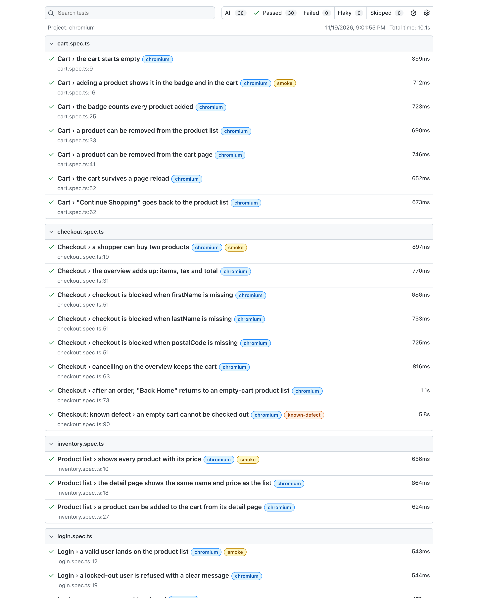

# QA automation with an AI agent: Playwright + TypeScript

**What this shows, in five lines**

1. A Playwright + TypeScript suite of 30 UI tests for a web shop: login, product list, sorting, cart, checkout, with negative cases.
2. Clean structure: page objects, typed fixtures, test data in one place, smoke tags, an HTML report, CI on every push.
3. A real AI workflow: an AI agent wrote five of the tests from a plain-language requirement.
4. A real repair: a selector broke, the agent found the cause, fixed it and proved the fix. Before and after are in the git history.
5. One engineer directs and reviews. The agent does the typing. The rules it follows are in [AGENTS.md](AGENTS.md).

**Run it in two commands** (needs Node.js 20 or newer)

```bash
npm run setup
```

```bash
npm test
```

Then `npm run report` opens the HTML report:



---

## The detail

### What is tested

The site under test is [saucedemo.com](https://www.saucedemo.com), a demo shop that Sauce Labs publishes for test practice.

| Area | Tests | Examples |
| --- | --- | --- |
| Login | 7 | valid login, locked-out user, wrong password, required fields, no access without login, logout ends the session |
| Product list | 3 | all products and prices, detail page matches the list |
| Sorting | 5 | written by the AI agent from [REQ-001](ai/requirements/REQ-001-sort-products.md) |
| Cart | 7 | add, remove, badge count, cart survives a reload |
| Checkout | 8 | full purchase, totals add up, each required field, cancel keeps the cart, one known defect |

The demo shop has no public API, so there are no API tests here.

### The AI workflow

The full worked example is in [docs/AI-WORKFLOW.md](docs/AI-WORKFLOW.md). The short version:

1. **Requirement.** A user story with acceptance criteria, in plain language.
2. **Write.** The agent reads the requirement and the rules, looks at the real page, and writes the tests.
3. **Run.** The agent runs them. A human reviews the diff.
4. **Break.** A front-end release renames an attribute. Five tests fail.
5. **Repair.** The agent reads the failure, decides "the test is out of date, the product is fine", fixes one line and proves the fix against both versions of the page.

You can replay the break yourself:

```bash
npm run test:simulated-release
```

### Commands

| Command | What it does |
| --- | --- |
| `npm test` | Full run, headless |
| `npm run test:smoke` | The 4 smoke tests only |
| `npm run test:headed` | Watch the browser work |
| `npm run test:ui` | Playwright's UI mode |
| `npm run test:simulated-release` | Sorting tests against a simulated front-end release |
| `npm run report` | Open the last HTML report |
| `npm run typecheck` / `npm run lint` | TypeScript and ESLint checks |

### How it is built

```
playwright.config.ts     retries, workers, report, failure evidence
src/pages/               page objects: every selector lives here
src/fixtures/test.ts     typed fixtures: page objects + one shared sign-in per worker
src/data/                users, products, customers
src/support/             money helper, simulated release
tests/                   the specs, in plain behaviour language
ai/requirements/         what the AI agent is asked to cover
AGENTS.md                the rules the AI agent follows
.github/workflows/       CI: type check, lint, tests, stored report
```

Choices worth a look:

- **No selectors in tests.** A changed page means one fix in one page object.
- **Sign in once per worker,** through the real form, then reuse the session. Login tests opt out and start signed out.
- **Evidence only on failure:** trace, screenshot and video.
- **Retries on CI only** (2). A test that needs a retry is reported as flaky, not hidden.
- **A known defect is tracked, not skipped.** The shop accepts an order with an empty cart. That test is marked `test.fail`, so the suite stays green and tells us the day the defect is fixed.
- **Small load on a free site:** one browser, at most three workers.

### About

Built by Gabriel Duma, Senior QA Automation Engineer, working with an AI coding agent.
The agent wrote most of the code. I set the rules, review every change and own the result.
